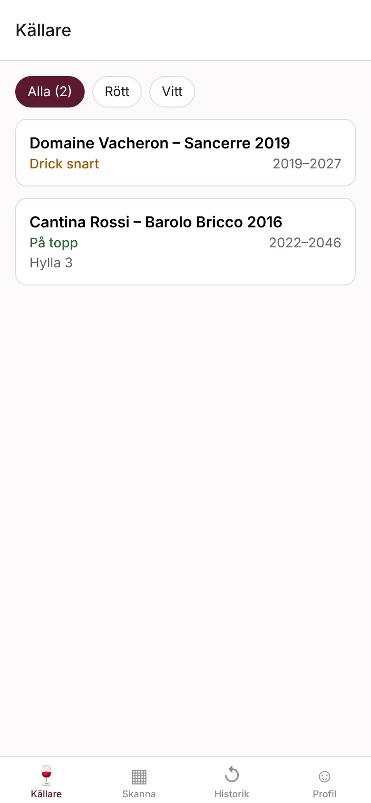
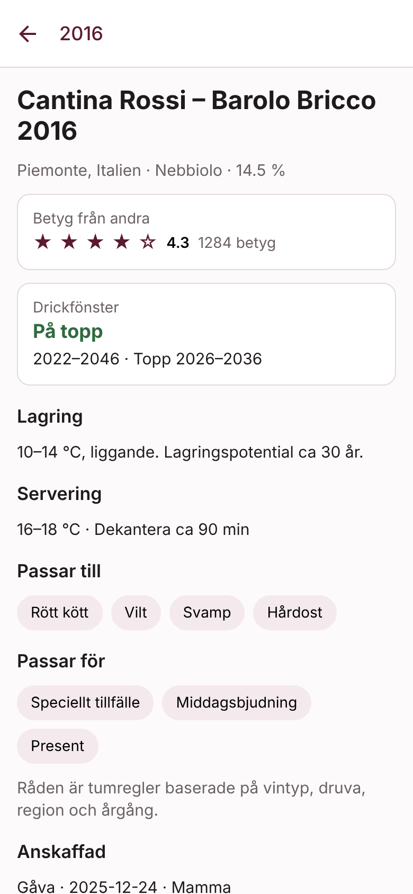
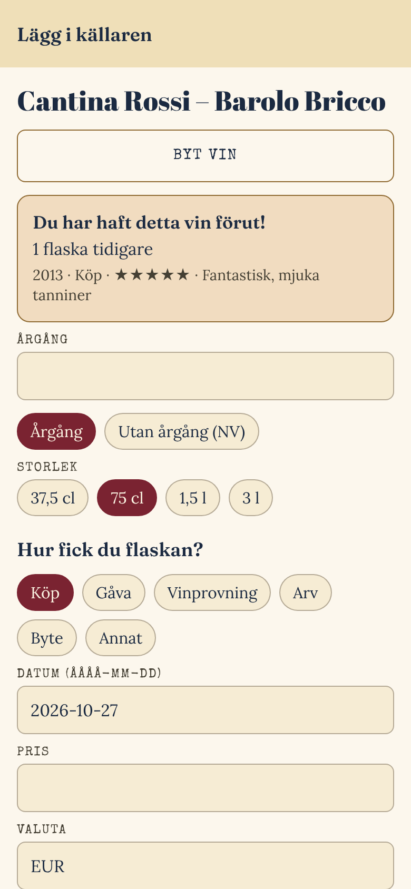

# Trand-vine

Vinapp: skanna streckkoden på en flaska → appen hittar vinet, visar betyg från
andra användare, du anger hur du fick flaskan (köp, gåva, …) och får råd om
lagring, drickfönster, servering, mat och tillfälle. Har du haft vinet förut
visas din historik direkt.

Bakgrund och beslut: [docs/ARKITEKTUR.md](docs/ARKITEKTUR.md).
Utseendet kommer från designsystemet i [docs/DESIGNSYSTEM.md](docs/DESIGNSYSTEM.md) (temat Tour).

<p>
  
  
  
</p>

## Struktur

```
apps/mobile/            Expo-app (iOS, Android, webb) – expo-router, expo-camera
packages/design/        Designsystem: temana party (Partyplan) och tour (Mallorca)
packages/core/          Delad logik: streckkoder, datakällor, regelmotor för råd, texter sv/en
packages/importers/     Import av öppna dataset (X-Wines, LWIN) till databasen
backend/supabase/       Databasschema (Postgres + RLS), serverfunktion lookup-barcode, tester
scripts/test-db.sh      Kör databastester mot en temporär lokal Postgres
```

## Datakällor (gratis)

| Källa | Används till |
|---|---|
| Egen databas | Bekräftade streckkoder → vin. Växer för varje användare som registrerar en flaska. |
| [Open Food Facts](https://world.openfoodfacts.org) | Streckkod → produkt (öppet API) |
| [UPCitemdb](https://www.upcitemdb.com) | Streckkod → produkt (100 uppslag/dag gratis) |
| [X-Wines](https://github.com/rogerioxavier/X-Wines) (CC0) | ~100 000 viner, druvor, matkombinationer och 21 milj. betyg som startbetyg |
| [LWIN](https://www.liv-ex.com/lwin/get-lwin-database) (CC) | 200 000+ viner för sökning och identifiering |
| [Alkos prislista](https://www.alko.fi/valikoimat-ja-hinnasto/hinnasto) (Finland) | Viner med streckkoder (EAN) – skanning av flaskor som också säljs i Finland ger direkt träff |
| [Vinmonopolet](https://api.vinmonopolet.no) (Norge, öppet API) | Viner med streckkoder (GTIN), kräver gratis nyckel |
| [Google Cloud Vision](https://cloud.google.com/vision) | Etikettfoto → text → vinet i registret (gratis upp till 1 000 bilder/månad; appen stannar på 950) |
| Systembolagets sortiment ([spegel](https://github.com/AlexGustafsson/systembolaget-api-data)) | ~6 000 viner med svenska namn, artikelnummer, pris och årgång. Sök på nummer från hyllkant/kvitto eller klistra in en länk från systembolaget.se. Innehåller inga streckkoder. |

Råden kommer från en regelmotor (`packages/core/src/recommend.ts`) som körs i
appen – gratis och fungerar offline. "Lär dig mer" (druvans karaktär och
aromer, områdets klimat och jordmån, sommeliertips) kommer från
kunskapsbanken i `packages/core/src/knowledge.ts`, ca 30 druvor och 40 områden
på svenska och engelska. Varje druva och område är faktagranskat mot källor
(`packages/core/src/knowledgeSources.ts`), som visas som "Läs mer" i appen.
Druvor och områden utanför kunskapsbanken kompletteras från
[Wikidata](https://www.wikidata.org) (CC0, ca 700 druvor och 500 områden med
Wikipedia-länkar) via funktionen `wikidata-sync`; kör den med
`'{"action":"sync"}'` (samma engångsnyckel som importen) för att uppdatera.

## Kom igång

Kräver Node 20+ och ett (gratis) [Supabase](https://supabase.com)-projekt.

```bash
npm install
```

### 1. Databas och serverfunktion

```bash
npx supabase --workdir backend link --project-ref <projekt-ref>
npx supabase --workdir backend db push                          # schema
npx supabase --workdir backend functions deploy lookup-barcode  # streckkodsuppslag
```

**Konton och inbjudningskod** (som festkoden i Fredrik55):

- Varje enhet startar som anonym användare (slå på **Authentication → Sign In /
  Providers → Allow anonymous sign-ins**).
- Appen kräver en **inbjudningskod** innan man kan lägga till något. Koden
  skapas av admin under Profil → Admin och kan delas som länk (`/?kod=…`).
  Databasen spärrar allt utan godkänd kod (restriktiva RLS-policyer).
- Under Profil sparar man källaren med **e-post och engångskod**: det anonyma
  kontot blir permanent (samma id, källaren följer med). Finns kontot redan
  loggar man in och den här enhetens flaskor flyttas dit.
- **Admin** är e-postadresser i `private.admin_emails` (läggs in med SQL:
  `insert into private.admin_emails values ('du@example.com');`) som loggat in
  med e-postkod. Admin ser statistik, skapar och stänger av koder och ger eller
  tar bort tillgång.
- Med Supabases standardmejl kommer en **länk** som loggar in på webben
  (kräver att **Authentication → URL Configuration → Site URL** är appens
  adress, t.ex. `https://trandvine.fred71.se`). Lägg till `{{ .Token }}` i
  mallarna **Magic Link** och **Change Email Address** så kommer även en
  sexsiffrig kod, som fungerar i telefonappen. Supabases inbyggda e-post klarar bara några mejl i timmen; koppla
  egen SMTP (t.ex. Resend) under Authentication → SMTP Settings för riktiga
  användare.

### 2. Importera vindata (valfritt men rekommenderat)

**Viner direkt i Supabase:** funktionen `import-xwines` laddar ner vinfilen från
X-Wines Google Drive och importerar den, utan att något laddas ner lokalt. Den
startas från databasen (SQL-editorn) med en engångsnyckel:

```sql
with t as (insert into private.import_tokens default values returning token)
select net.http_post(
  url := 'https://<projekt>.supabase.co/functions/v1/import-xwines',
  body := '{"action":"wines","fileId":"1uEEipmKNxdiKUAhjH-K14JOSQ2BLRFss"}'::jsonb,
  headers := jsonb_build_object('Content-Type','application/json','x-import-token',(select token from t)),
  timeout_milliseconds := 400000);
-- Svaret: select * from net._http_response order by id desc limit 1;
-- Svarar den med "next": kör igen med "skip": <next>.
```

Systembolagets sortiment importeras på samma sätt med
`'{"action":"systembolaget"}'` som body (valfritt `"url"` till en annan spegel i
samma format). Kör om när sortimentet ska uppdateras. Från egen dator:
`npm run systembolaget -w @trand-vine/importers -- assortment.json > sb.sql`.

**Alko:** Alko spärrar automatisk nedladdning. Ladda ner prislistan
(xlsx) i webbläsaren, lägg upp den i Supabase Storage i hinken `imports`
(publik) och kör importen med `'{"action":"alko","url":"https://<projekt>.supabase.co/storage/v1/object/public/imports/alkon-hinnasto-tekstitiedostona.xlsx"}'`.
Lägg till `"dryRun": true` för att först se rubriker och exempel.

**Vinmonopolet:** registrera dig på [api.vinmonopolet.no](https://api.vinmonopolet.no),
prenumerera på produkten *Open* och lägg nyckeln som hemligheten
`VINMONOPOLET_API_KEY` (Supabase → Edge Functions → Secrets). Kör sedan
importen med `'{"action":"vinmonopolet","dryRun":true}'` och därefter utan `dryRun`.

**Etikettfoto:** skapa en API-nyckel för Cloud Vision API i Google Cloud
(kräver ett faktureringskonto även för gratiskvoten), begränsa nyckeln till
Cloud Vision API och lägg den som hemligheten `GOOGLE_VISION_API_KEY`.
Funktionen `read-label` tar emot fotot från appen.

Betygen (21 miljoner rader) är för stora för en funktionskörning; de importeras
med GitHub-flödet nedan.

**Enklast: GitHub Action.** Lägg Supabase-adressen som hemlighet `SUPABASE_DB_URL`
(Supabase → Project Settings → Database → Connection string → **Session pooler**)
under GitHub → Settings → Secrets and variables → Actions. Kör sedan
**Actions → Importera X-Wines → Run workflow**. Den laddar ner X-Wines från
datasetets Google Drive och importerar viner och betyg.

Manuellt från egen dator:

```bash
# X-Wines: ladda ner Full-versionen (länk i X-Wines README) till data/raw/
npm run xwines -w @trand-vine/importers -- data/raw/XWines_Full_100K_wines.csv data/raw/XWines_Full_21M_ratings.csv > data/raw/xwines.sql
psql "$DATABASE_URL" -f data/raw/xwines.sql

# LWIN: ladda ner XLSX från Liv-ex, spara som CSV (UTF-8)
npm run lwin -w @trand-vine/importers -- data/raw/lwin.csv > data/raw/lwin.sql
psql "$DATABASE_URL" -f data/raw/lwin.sql
```

`DATABASE_URL` finns under **Project Settings → Database → Connection string**.
Importen kan köras om; befintliga rader uppdateras.

X-Wines ska citeras: de Azambuja, R.X.; Morais, A.J.; Filipe, V. *X-Wines: A Wine
Dataset for Recommender Systems and Machine Learning.* Big Data Cogn. Comput.
2023, 7, 20. https://doi.org/10.3390/bdcc7010020

### 3. Starta appen

```bash
cp apps/mobile/.env.example apps/mobile/.env   # fyll i URL och anon-nyckel
cd apps/mobile && npx expo start
```

Kameran kräver en riktig telefon (Expo Go eller development build).

### 4. Webbversion på Vercel (valfritt)

Importera repot i Vercel och låt rotmappen vara projektets rot; `vercel.json`
sköter bygget (`npm run build:web`, utdata i `dist/`). Lägg in
`EXPO_PUBLIC_SUPABASE_URL` och `EXPO_PUBLIC_SUPABASE_ANON_KEY` under
**Settings → Environment Variables** innan första bygget. Webbversionen har
inte testats med kameraskanning; sökningen fungerar alltid.

## Tester

```bash
npm test            # enhetstester (core, importers)
npm run typecheck   # TypeScript i alla paket
npm run test:db     # schema, RLS, triggrar och import mot lokal Postgres 15+
```
