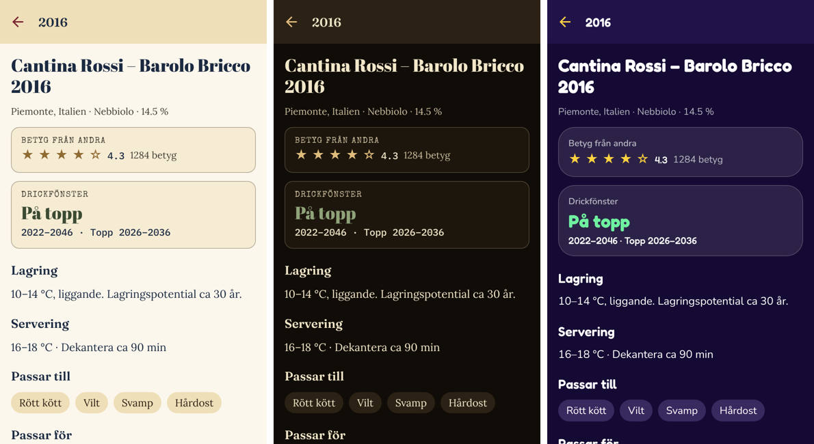

# Designsystem

Ett gemensamt designsystem för FreWer71:s appar, i `packages/design`. Det har
två familjer med **samma semantiska tokens**, så en app byter utseende genom
att byta tema – komponenterna ändras inte.

| Familj | Används för | Ursprung | Känsla |
|---|---|---|---|
| `party` | Nöjesappar (fester, spel, tävlingar) | Partyplan / [Fredrik55](https://github.com/FreWer71-ready/Fredrik55) | Natthimmel, cerise, turkos, solgul. Fredoka + Nunito. Rundat, knappar med 3D-tryck. Alltid mörkt. |
| `tour` | Resor, samlingar, klassiska appar | [Mallorca Golf Tour](https://github.com/FreWer71-ready/golftour) | Vintageaffisch: pergament, vinröd, guld. Abril Fatface, Fraunces, Lora, Special Elite, IBM Plex Mono. Ljust och mörkt läge. |

**Trand-vine använder `tour`.**



## Tokens

Alla teman definierar samma nycklar (`packages/design/src/tokens.ts`):

- **Färg:** `background`, `surface`, `surfaceRaised`, `highlight`, `border`,
  `text`, `textMuted`, `primary`/`onPrimary`/`primaryEdge`,
  `secondary`/`onSecondary`/`secondaryEdge`, `accent`, `navActive`,
  `success`, `warning`, `danger`, `tag`/`onTag`
- **Typsnitt** (roller): `display`, `heading`, `body`, `bodyStrong`, `label`, `data`
  – vart och ett med CSS-stack, React Native-namn och Google Fonts-familj
- **Typskala:** `display`, `title`, `heading`, `body`, `small`, `label`
- **Avstånd:** `xs` 4 · `sm` 8 · `md` 12 · `lg` 16 · `xl` 24
- **Radier:** `card`, `button`, `field`, `chip`
- **Knappstil:** `press` (party: färgad kant under knappen som trycks ner) eller
  `flat` (tour: ram, etikett i versaler med spärrning)
- **Etiketter:** versaler och spärrning i tour, vanlig text i party

Testerna kontrollerar att alla teman har samma nycklar och att text, knappar
och statusfärger klarar WCAG AA-kontrast.

## Regler

1. Komponenter läser **bara semantiska tokens** – aldrig hex-värden eller
   palettnamn som "cerise" eller "maroon".
2. `display` används sparsamt: sidtitlar och stora siffror.
3. `label` för små rubriker och fältetiketter; i tour blir de versaler automatiskt.
4. Statusfärger (`success`/`warning`/`danger`) betyder status, inte dekoration.
5. Nya färger läggs till som semantiska tokens i **alla** teman samtidigt.

## Använda i en Expo/React Native-app

Se `apps/mobile/src/lib/theme.tsx` och `apps/mobile/src/components/ui.tsx`:

```tsx
import { getTheme } from "@trand-vine/design";
const theme = getTheme("tour", colorScheme === "dark" ? "dark" : "light");
<Text style={{ color: theme.colors.text, fontFamily: theme.fonts.body.native }} />
```

Typsnitten laddas med `@expo-google-fonts/*` och `expo-font`
(`nativeFontNames(family)` listar vilka som behövs).

## Använda i en webbapp (Next.js, Tailwind v4, Vite)

```bash
npm run css -w @trand-vine/design -- tour > theme.css    # eller party
```

Filen innehåller `--color-*`, `--font-*`, `--radius-*`, `--space-*` och
`--text-*` för ljust och mörkt läge, plus en kommentar med Google Fonts-länken.
I Tailwind v4 kan variablerna användas direkt i `@theme`.
